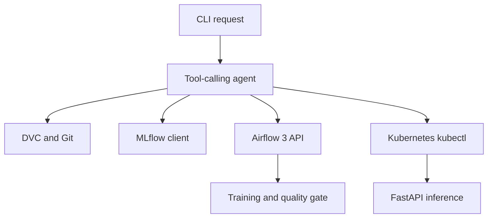

# Architecture

The CLI accepts a natural-language request and sends it to an OpenAI-compatible model with JSON tool definitions. The model selects operations; the orchestrator checks argument types, applies approval gates, executes fixed tool methods, and attaches their responses as evidence. A deterministic audit mode checks all four services without model access.

| Module | Read operations | State-changing operation |
| --- | --- | --- |
| DVC | List, version, diff, status, reproduction plan | None; checkout is a printed plan |
| MLflow | Experiments, runs, metrics, artifacts, registry | None |
| Airflow | DAGs, runs, status, failures, logs | Trigger only the approved DAG with explicit CLI approval |
| Kubernetes | Pods, Deployment, Service, events, logs, version | Restart only equipment-api in mlops-agent with explicit CLI approval |

The agent passes no arbitrary command strings to Git, DVC, kubectl, or Airflow. Invalid tool arguments and unknown tool names are rejected before execution. Each call records a request ID, tool name, status, and duration. Responses are redacted before being sent back to the model. A failed tool returns an unavailable state; if all tools fail, the model's unsupported final answer is discarded.

The Airflow DAG checks DVC provenance before training, writes run-specific model and metric files, logs the results to MLflow, and evaluates an F1 gate. There are two retries per task. Failure in validation stops later tasks. Failure at the quality gate prevents a successful workflow result; no deployment is performed by the DAG.

The Docker image contains a JSON logistic regression model restored from DVC. The Deployment has two desired replicas, probes, resource bounds, and a ConfigMap. The API checks the model at readiness and returns the dataset SHA-256 with predictions. The image currently has no MLflow run ID. An available Pod therefore proves only that the image is serving, not that it serves the best recorded MLflow candidate.
